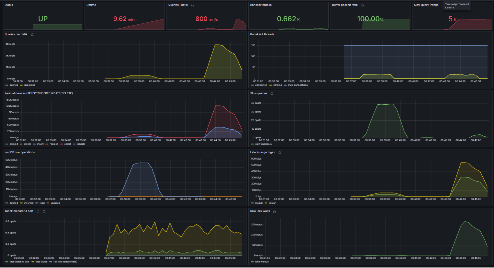
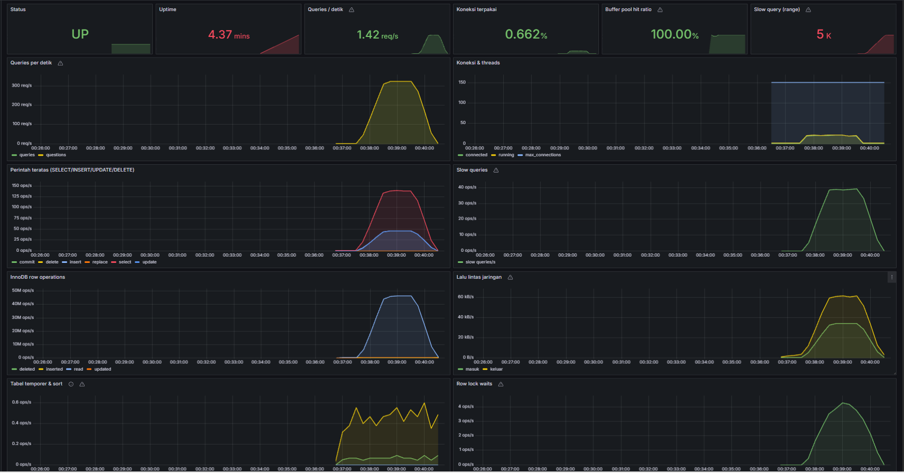
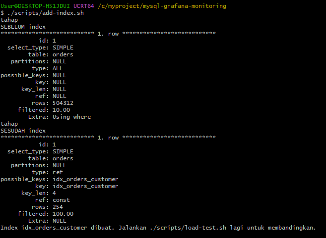

# MySQL Observability & Performance Tuning

Stack monitoring MySQL siap produksi (**Prometheus + Grafana + Alertmanager → Telegram**), lengkap dengan studi kasus tuning performa pada database toko online berisi 500.000 pesanan yang diuji dengan beban 20 koneksi paralel.

> **Hasil utama:** satu perubahan index yang ditemukan lewat dashboard menaikkan throughput **8,4×** (45 → 381 transaksi/detik) dan memangkas baris yang di-scan per query dari **504.312 menjadi 254**.



---

## Studi kasus: dari 45 ke 381 transaksi per detik

### Kondisi awal
Database toko online dengan 2.000 pelanggan dan 500.000 pesanan. Beban disimulasikan selama 120 detik oleh 20 worker paralel yang menjalankan pola transaksi umum aplikasi e-commerce: melihat riwayat pesanan pelanggan, menghitung ringkasan belanja, membuat pesanan baru, dan mengurangi stok.

### Gejala yang terlihat di dashboard


- **Slow query ±40 per detik** (ambang 200 ms)
- **InnoDB membaca ±46 juta baris per detik**, sangat tidak sebanding dengan jumlah query yang hanya ±320 per detik
- Throughput hanya **45 transaksi/detik**

Rasio "baris dibaca vs query" yang ekstrem adalah tanda klasik query yang men-scan seluruh tabel.

### Analisis
`EXPLAIN` pada query riwayat pesanan mengonfirmasi dugaan:



| | Sebelum | Sesudah |
|---|---|---|
| `type` | `ALL` (full table scan) | `ref` (lookup via index) |
| `key` | `NULL` | `idx_orders_customer` |
| `rows` diperiksa | 504.312 | 254 |
| `filtered` | 10% | 100% |

Kolom `orders.customer_id` dipakai di klausa `WHERE` dan `JOIN` pada hampir setiap transaksi, tetapi tidak memiliki index.

### Solusi
```sql
CREATE INDEX idx_orders_customer ON orders(customer_id);
```

### Hasil (beban yang sama, 120 detik, 20 worker)

| Metrik | Sebelum | Sesudah | Perubahan |
|---|---|---|---|
| Total transaksi | 5.480 | 45.836 | **8,4×** |
| Transaksi per detik | 45 | 381 | **8,4×** |
| Baris di-scan per query | 504.312 | 254 | **±2.000× lebih sedikit** |
| Slow query | ±40/detik | mendekati 0 | **turun >90%** |
| Baris dibaca InnoDB | ±46 juta/detik | mendekati 0 | |

### Temuan lanjutan: bottleneck berikutnya
Setelah index dipasang, panel **Row lock waits** naik dari ±4 menjadi ±330 per detik. Dengan query baca tidak lagi menjadi penghambat, transaksi kini antre pada `UPDATE products SET stock = stock - 1` karena 20 koneksi berebut mengubah 5 baris yang sama (*hot row contention*).

Opsi perbaikan, sesuai kebutuhan bisnis:
1. **Menjaga transaksi pengurangan stok sesingkat mungkin** dan menaruhnya di akhir transaksi.
2. **Reservasi stok berbasis antrean** (misalnya lewat message queue) untuk produk yang sangat laris.
3. **Memecah stok ke beberapa baris** (*sharded counter*) dan menjumlahkannya saat dibaca.

Inilah alasan monitoring berkelanjutan penting: setiap optimasi menggeser bottleneck ke tempat lain, dan dashboard yang tepat langsung menunjukkannya.

---

## Isi stack

- **Dashboard Grafana 14 panel** yang ter-provision otomatis: status, uptime, QPS, pemakaian koneksi, buffer pool hit ratio, slow query, perintah per tipe, InnoDB row operations, lalu lintas jaringan, tabel temporer, full join tanpa index, dan row lock waits.
- **6 aturan alert ke Telegram:**

  | Alert | Kapan berbunyi |
  |---|---|
  | MySQLDown | MySQL tidak bisa dihubungi > 1 menit |
  | MySQLTooManyConnections | Koneksi > 80% dari `max_connections` |
  | MySQLHighThreadsRunning | > 30 thread aktif (indikasi query berat atau lock) |
  | MySQLSlowQueries | > 10 slow query dalam 5 menit |
  | MySQLRestarted | MySQL baru restart |
  | MySQLLowBufferPoolHitRatio | Hit ratio < 95% selama 10 menit |

- **User monitoring least-privilege:** exporter hanya memiliki hak `PROCESS, REPLICATION CLIENT, SELECT` dengan batas 3 koneksi, bukan root.
- **Skrip load test & tuning** untuk mereproduksi studi kasus di atas.

## Arsitektur

```
MySQL 8.4 ──► mysqld-exporter ──► Prometheus ──► Grafana (dashboard)
                                      │
                                      └──► Alertmanager ──► Telegram
```

## Menjalankan

Kebutuhan: Docker dan Docker Compose. Di Windows, jalankan skrip `.sh` dari Git Bash.

```bash
cp .env.example .env               # ganti semua password di .env
docker compose up -d               # tunggu ±1 menit untuk inisialisasi data

./scripts/load-test.sh             # beban 120 detik, 20 worker
./scripts/add-index.sh             # terapkan tuning + tampilkan EXPLAIN
./scripts/load-test.sh             # ukur ulang
```

| Layanan | Alamat |
|---|---|
| Grafana | http://localhost:3000 |
| Prometheus | http://localhost:9090 |
| Alertmanager | http://localhost:9093 |
| MySQL | `localhost:3307` |

Untuk mengulang dari kondisi awal: `docker compose down -v && docker compose up -d`.

### Notifikasi Telegram
1. Buat bot lewat **@BotFather** dan salin token-nya.
2. Kirim pesan ke bot, lalu ambil `chat.id` dari `https://api.telegram.org/bot<TOKEN>/getUpdates`.
3. Isi keduanya di `alertmanager/alertmanager.yml`, lalu `docker compose restart alertmanager`.

## Menerapkan ke server produksi

Untuk memantau MySQL yang sudah berjalan, cukup deploy `mysqld-exporter` dan arahkan `host` di `exporter/my.cnf` ke server tersebut; Prometheus, Grafana, dan Alertmanager bisa ditempatkan di server monitoring terpisah. Rekomendasi:
- jangan membuka port Grafana/Prometheus/Alertmanager ke internet tanpa reverse proxy + HTTPS dan autentikasi,
- sesuaikan retensi Prometheus (default di sini 15 hari),
- uji index baru di staging terlebih dahulu; pada tabel besar gunakan `ALGORITHM=INPLACE, LOCK=NONE` atau tool online schema change,
- simpan `.env` dan token Telegram di luar repository.

---

## Jasa

Saya membantu tim dan bisnis memantau serta mempercepat database MySQL: setup monitoring & alerting, analisis slow query dan tuning index, backup otomatis, serta maintenance bulanan. Hubungi saya lewat www.linkedin.com/in/andhika-suryamiharja atau suryamiharja96@gmail.com .
